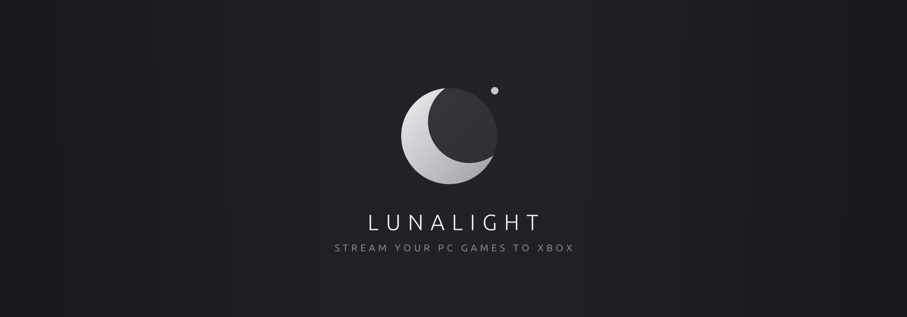
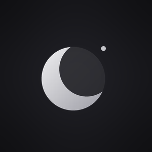
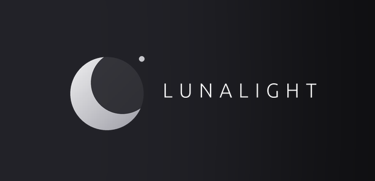

<p align="center">
  
</p>

<p align="center">
  Stream games from your PC to the Xbox One and Xbox Series X|S with <a href="https://github.com/LizardByte/sunshine">Sunshine</a> or GeForce Experience.
</p>

<p align="center">
  <a href="https://github.com/BilodeauIsADev/moonlight-xbox/releases">Releases</a> ·
  <a href="https://github.com/BilodeauIsADev/moonlight-xbox/actions">Bleeding edge builds</a> ·
  <a href="https://github.com/BilodeauIsADev/moonlight-xbox/issues">Issues</a>
</p>

---

Lunalight is a fork of [Moonlight UWP](https://github.com/TheElixZammuto/moonlight-xbox), the Xbox port of [Moonlight](https://moonlight-stream.org/). It keeps the same streaming core and adds a darker, monochrome look built around square game covers.

> [!NOTE]
> Lunalight is still in early development. Expect rough edges.

## Installation

Lunalight is not on the Microsoft Store. Install it on an Xbox in Dev Mode:

1. [Enable Dev Mode](https://learn.microsoft.com/en-us/windows/uwp/xbox-apps/devkit-activation) on your Xbox.
2. Download a build from [Releases](https://github.com/BilodeauIsADev/moonlight-xbox/releases), or a bleeding-edge build from [Actions](https://github.com/BilodeauIsADev/moonlight-xbox/actions).
3. In the Device Portal, install `moonlight-xbox-dx.msixbundle`, then add the dependencies `Microsoft.UI.Xaml.2.7.appx` and `Microsoft.VCLibs.x64.14.00.appx`.

## Usage

1. Start your host app (Sunshine or GeForce Experience) on your PC.
2. Open Lunalight on the Xbox. Your PC should already be in the list; if not, press **+**, enter its IP address and press **Connect**.
3. Pair if asked.
4. Pick a game from the list and play.

## Wake and sign in

Focus a sleeping paired PC and press **X** to wake it and open its Windows
sign-in screen with a controller keyboard. For an awake PC, choose **Sign in
to PC** from its options. After Windows unlocks, choose **Open library**.
See [setup and ASUS B550-F Gaming instructions](docs/wake-and-sign-in.md).

## PyroWave development preview

This branch includes the PyroWave implementation from Andy Grundman's
[1.19.0-pre1 prerelease](https://github.com/andygrundman/moonlight-xbox/releases/tag/1.19.0-pre1),
commit `d81d5a4673d9a4f165efcfabfd437e541d93a4eb`.

PyroWave requires an Xbox Series S or Series X, a wired gigabit network, and a
host that advertises PyroWave support, such as a compatible Vibeshine build.
The Xbox One family cannot run this compute decoder. For testing, sideload the
prerelease package in Xbox Dev Mode or build this branch on Windows.

After connecting to the host, open its settings and select **PyroWave 4:2:0** or
**PyroWave 4:4:4**. These options appear only after the host advertises the
corresponding codec. Use packet size **1392**. Start with the bitrate selected
by the app when changing codecs, then check the streaming statistics for
packet loss and dropped frames. HDR also requires a compatible host and display
with HDR enabled in the Xbox video settings.

Update submodules after switching to this branch:

```sh
git submodule update --init --recursive
```

The pinned PyroWave submodule includes the compiled D3D12 compute shaders; the
application project builds the decoder directly. A separate Vulkan build is
not required. See [the framing tests](tests/README.md) for checks that can run
without Windows or an Xbox. GPU decoding, HDR, frame pacing, and reconnects
still need testing on the console.

## Features

- Connection and pairing
- App list with square covers, game logos, and wide backgrounds from [SteamGridDB](https://www.steamgriddb.com/). Highlight a game with the controller or pointer to show its logo and background. Missing artwork falls back to the game title and dark background; covers fall back to the host's box art.
- Video streaming, configurable per host
- HDR
- Audio
- Gamepad input with rumble, battery reporting, and a mouse mode that moves the pointer with the gamepad
- Keyboard, both on-screen and hardware
- Host settings for resolution and bitrate, plus saved host history
- Graceful disconnection

### Not supported

- Hardware mouse (a UWP limitation)
- Anything not listed above

## Branding

<p>
  
  
</p>

Every tile, splash, store and icon asset comes from one script. To change the colors or proportions, edit the constants at the top of [`tools/generate-brand-assets.py`](tools/generate-brand-assets.py) and run:

```sh
python3 tools/generate-brand-assets.py
```

It needs Pillow and the Ubuntu Sans variable font.

## Building

### Requirements

- Windows 10 or later
- Visual Studio 2022 with the **WinUI Application Development** workload, including:
  - Windows 10 SDK (10.0.19041.0). Visual Studio 17.10+ marks it as out of support, but CMake still needs it.
  - Universal Windows Platform tools
  - C++ (v141, v142, v143) Universal Windows Platform tools

### Quick setup

1. Clone this repository.
2. Run `./setup-dev.ps1`.

### Manual setup

1. Clone this repository with submodules.
2. Install [vcpkg](https://vcpkg.io/en/index.html) and the dependencies:
   1. `git submodule update --init --recursive`
   2. `vcpkg\bootstrap-vcpkg.bat`
   3. `.\vcpkg\vcpkg.exe install --vcpkg-root vcpkg --triplet x64-uwp`
3. Open an x64 Developer Command Prompt (Tools → Command Line → Developer Command Prompt):
   1. Run `generate-thirdparty-projects.bat` to generate the `moonlight-common-c` project.
   2. In `libgamestream`, run `build-uwp.bat` to generate the `libgamestream` project.
4. Open `moonlight-xbox-dx.sln` in Visual Studio 2022 and build these projects, in order:
   - `enet`
   - `moonlight-common-c`
   - `gamestream`
5. Set up a signing certificate:
   1. In Solution Explorer, expand `moonlight-xbox-dx (Universal Windows)` and open `Package.appxmanifest`.
   2. On the **Packaging** tab, next to **Publisher**, click **Choose Certificate**.
   3. Pick an existing certificate, or click **Create...** to make one. A password isn't needed for personal or debug builds.
6. Optional: for SteamGridDB covers, logos, and backgrounds, copy `SteamGridDbKey.h.example` to `SteamGridDbKey.h` and paste your [API key](https://www.steamgriddb.com/profile/preferences/api). The file is gitignored. CI builds read it from the `STEAMGRIDDB_API_KEY` repository secret.
7. Build the solution.

## Credits

Lunalight builds on [Moonlight UWP](https://github.com/TheElixZammuto/moonlight-xbox) by TheElixZammuto and contributors, and on [moonlight-common-c](https://github.com/moonlight-stream/moonlight-common-c) from the Moonlight project. See [LICENSE](LICENSE).
